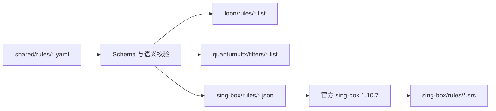

# 仓库架构与迁移决策

## 现状审计

升级前基线为默认分支 `main` 的 `179fb7c`。仓库已有五组 Loon / Quantumult X 规则、三个 Loon 插件及脚本、Bun 插件测试与客户端 README；当时没有 package.json、规则生成器或构建工作流。两端同名规则的域名、CIDR、顺序、元数据及候选项一致，只需转换域名关键字。Binance 含 15 条带 `no-resolve` 的 IPv4 主机规则；其他组包含较多有意禁用的共享服务候选项。

复用既有目录和脚本，保留所有插件行为、Rewrite v2 / Script v2 约束及测试。已有公开路径不移动。配置与脚本预留目录继续保留；本次只创建确有内容的新目录，不扩展为订阅平台。

## 单一规则源

`shared/rules/` 维护匹配条件及说明，客户端目录只分发生成结果。`tools/rulegen/src/` 负责加载、严格校验、目标渲染、官方编译和产物检查；`tools/rulegen/tests/` 负责边界、迁移及集成回归。Bun 直接执行 TypeScript；不引入打包框架和运行服务。开发依赖及其完整性由 `package.json` 和 `bun.lock` 管理。

唯一运行时依赖为固定版本的 `yaml`：它能严格拒绝重复映射键，避免 Bun 内置解析器静默覆盖配置。`.npmrc` 指定官方 HTTPS npm Registry，lockfile 固定依赖版本与完整性，不依赖开发环境的地区镜像。

Schema v1 支持四种匹配条件，数组定义分组与规则顺序，结构化字符串保留输出注释，`enabled: false` 保留候选项。元数据中的更新时间由维护者填写；构建不注入当前时间或机器绝对路径。来源仍保留原有抓包说明，但不提交原始抓包内容。

每条启用条件转换为独立 sing-box headless rule，保持源顺序；同一规则集是同一策略下的匹配集合。SRS 编译可能规范化单条规则内部表示，因此校验解析结果的有效条件，而不依赖其格式文本。JSON 不增加不属于官方 Schema 的元数据字段；注释和候选项保存在 YAML / `.list`。

## 兼容性边界

保留 `loon/rules/<name>.list` 和 `quantumultx/filters/<name>.list`。迁移测试保存旧列表快照，比较生成结果的完整字节，覆盖元数据、注释、空行、启用状态及顺序。快照不是规则维护源；以后有意改变规则时，应在评审中明确说明与基线的差异。

Loon、Quantumult X 和 sing-box 的 DNS 求值机制并不完全等价。Binance 的 `no-resolve` 不可当成普通文本后缀无条件复制到每端：YAML 必须显式声明兼容选择，未知或无法接受的语义直接报错。当前 QX 保留历史第三字段文本，并要求订阅绑定 `force-policy`；sing-box 要求调用方遵守不预解析约束。详见 [规则格式](rule-format.md)。匹配集合一致性的测试不代表所有客户端主配置下 DNS 行为一致。

sing-box 输出 version 2，消费者最低 1.10.0；固定官方 1.10.7 编译，避免换用不同编译器导致二进制漂移。当前五组产物很小、维护频率低，SRS 直接提交，使用稳定 Raw URL。未来若体积显著增长，再单独设计 Release 发布迁移，不能直接破坏已有订阅地址。

## CI 数据流

PR、推送 `main` 和手动运行触发 `.github/workflows/build-rules.yml`。流程为固定 Bun、缓存并安装锁定依赖 → 验证下载的官方编译器 SHA256 → 类型检查及所有测试 → 验证全部 YAML → 在临时目录生成三端产物 → 对比工作树已提交产物。任何失败均阻止通过；CI 不自动更新源码、提交产物或合并 PR。

第三方 Actions 固定 Commit SHA，GitHub Token 仅有 `contents: read`。不设定时刷新；不会访问未经声明的远程规则源，也不上传原始输入或构建 Artifacts。

## 公共与私人隔离

公开仓库仅存公开规则和工具。未来私人仓库将公开生成器按固定 Commit SHA checkout 到独立目录，在其自身 CI 内读取私人 YAML，并用绝对路径指定私人输出根目录。生成器无需复制代码，也不需要公开仓库获得私人仓库权限。

公共 CI 不读取私人数据；私人 CI 不向公开仓库推送，不将原始输入或产物上传为公共附件，不将域名、IP、Token 或编译器原始错误写入日志。生成器只输出必要的结构定位与失败类别。私人仓库或受控存储中的结果如何授权分发由私人环境管理；本次不创建私人仓库、Workers 或 R2。操作示例见 [Private 集成](private-integration.md)。
